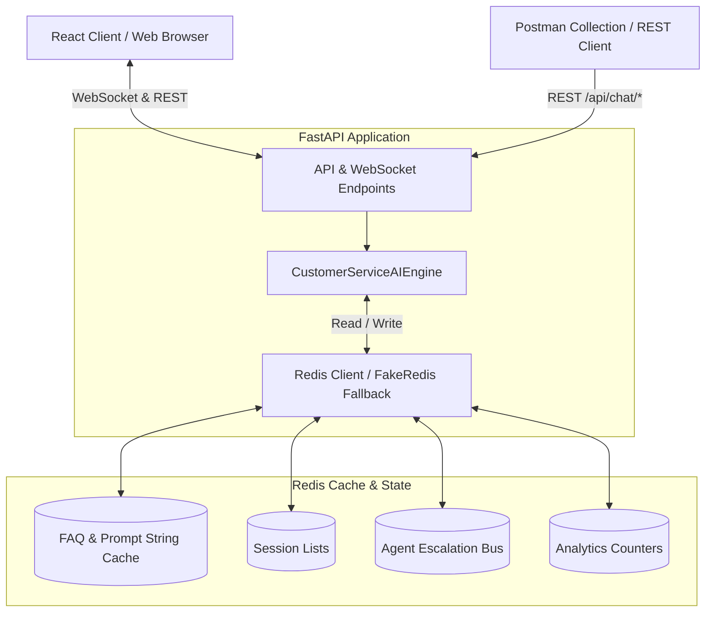

# OmniSupport AI — Enterprise Customer Service Chatbot System 🤖⚡

[](https://fastapi.tiangolo.com)
[](https://redis.io)
[](https://react.dev)
[](https://vitejs.dev)
[](LICENSE)

An enterprise-grade, full-stack AI Customer Service platform combining high-throughput **FastAPI** microservices, multi-tier **Redis** caching and pub/sub orchestration, and a modern **React (Vite)** glassmorphic single-page application.

---

## 🌟 Key Capabilities & Features

### 1. 💬 Intelligent Customer Portal (`/`)
- **Multi-Intent AI Engine**: Categorizes incoming customer inquiries into Order Tracking, Returns & Refunds, Technical Troubleshooting, and Account Access.
- **Dual Communication Protocol**: Real-time **WebSocket streaming** (`/ws/chat/{session_id}`) with seamless fallback to **REST API** (`/api/chat/message`).
- **Voice-Enabled**: Native browser Speech-to-Text (STT) input and Text-to-Speech (TTS) auditory response toggling.
- **Dynamic Interactive UI Cards**: Interactive step-by-step order progress timeline, one-click return claim generator, and 5-star CSAT survey modal.

### 2. ⚡ Multi-Tier Redis Performance Architecture
- **Microsecond FAQ Response Cache**: Frequently asked questions are cached with custom TTLs using Redis string keys (`setex`), cutting response latencies below 5ms.
- **Contextual Session State Store**: Chat history and conversation state persisted in Redis Lists (`session:<id>:messages`).
- **Prompt & VIP Context Caching**: Dedicated endpoint (`/api/chat/cached-prompt`) leveraging Redis TTL caching for customer profiles and VIP policies.
- **Real-Time Pub/Sub Bus**: Redis channels broadcast handoff signals when conversations require live human operator escalation.
- **Zero-Dependency Fallback**: Built-in automatic fallback to `fakeredis` in-memory engine if a standalone Redis instance is not detected.

### 3. 🧑‍💼 Human Agent Operator Workspace
- **Live Ticket Dashboard**: Real-time visualization of `tickets:pending` and `tickets:active` queues.
- **Instant Agent Takeover**: Support agents can claim conversations from AI with zero disconnect.
- **Canned Responses**: Pre-configured rapid reply templates for standard customer service scenarios.

### 4. 📊 Real-Time Analytics & CSAT Metrics
- Tracks AI auto-resolution rate, CSAT ratings, average resolution duration, top inquiry topics, and Redis cache hit ratios via atomic counters (`INCR`, `ZADD`).

### 5. 🔍 Live Redis Key Inspector
- Built-in administrator tool to inspect active Redis keys, data types (String, List, Hash, Set), remaining TTL countdowns, and raw serialized payloads.

---

## 🏗️ Architecture & Data Flow



---

## 📁 Directory Structure

```
chatbot/
├── backend/
│   ├── app/
│   │   ├── ai_engine.py         # Intent classification & context synthesis
│   │   ├── config.py            # Environment settings and TTL configs
│   │   ├── models.py            # Pydantic schemas (Request / Response / Context)
│   │   ├── redis_client.py      # Redis connector with automatic in-memory fallback
│   │   └── routers/
│   │       ├── chat.py          # Chat routes, WebSockets, /cached-prompt
│   │       └── admin.py         # Metrics and Redis inspection endpoints
│   ├── requirements.txt         # Backend Python dependencies
│   └── run.py                   # FastAPI server entry point
├── frontend/
│   ├── src/
│   │   ├── components/          # Chat, Agent Portal, Metrics, Redis Inspector
│   │   ├── App.jsx              # Main tabbed view orchestration
│   │   └── index.css            # Custom glassmorphic styling
│   ├── package.json             # React 18, Vite 5, Lucide dependencies
│   └── vite.config.js           # Vite development server config
├── OmniChatbot_RedisCache.postman_collection.json  # Comprehensive API test suite
├── .gitignore                   # Exclusions for virtualenvs, node_modules
└── README.md                    # Project documentation
```

---

## 🚀 Quickstart Guide

### Option A: Local Development

#### 1. Backend Service
```bash
cd backend

# Create virtual environment
python3 -m venv venv
source venv/bin/activate

# Install dependencies
pip install -r requirements.txt

# Launch FastAPI backend server
PYTHONPATH=. python run.py
```
> The API will be available at: **`http://localhost:8000`**  
> Interactive OpenAPI documentation: **`http://localhost:8000/docs`**

#### 2. Frontend Application
```bash
cd frontend

# Install dependencies
npm install

# Start Vite development server
npm run dev
```
> The web interface will open at: **`http://localhost:5173`**

---

## 🧪 Postman Collection & Testing

A pre-configured Postman collection is included: **`OmniChatbot_RedisCache.postman_collection.json`**

Import this file into [Postman](https://www.postman.com) to test:
1. **Send Message & Cache Warmup**: `POST /api/chat/message`
2. **Context & Prompt Cache Verification**: `POST /api/chat/cached-prompt`
3. **Agent Escalation & Queue**: `GET /api/admin/tickets`
4. **Redis Telemetry & Cache Metrics**: `GET /api/admin/metrics`

---

## 📄 License

This repository is distributed under the [MIT License](LICENSE).
